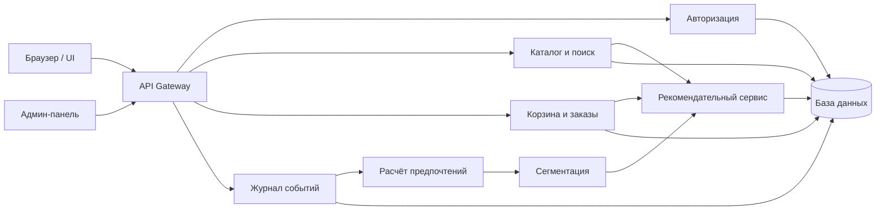
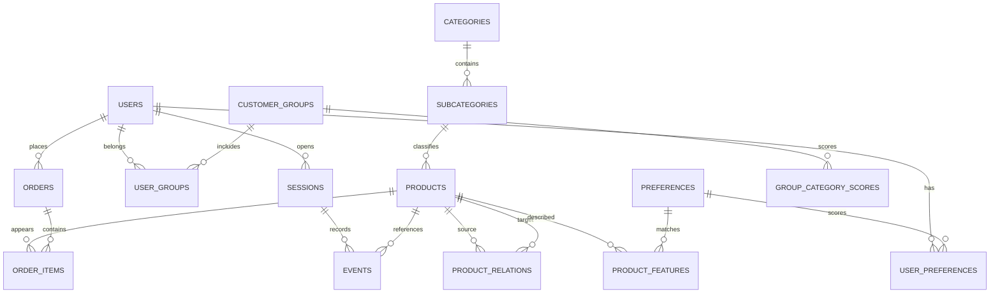
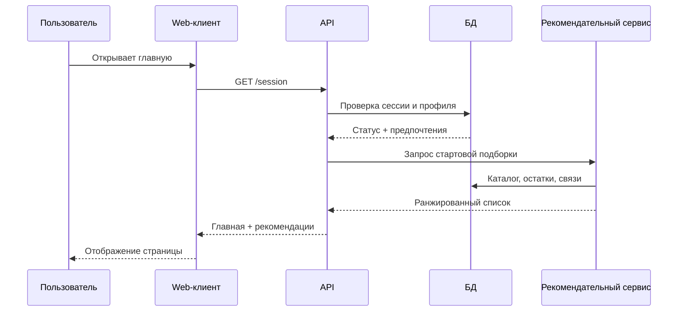
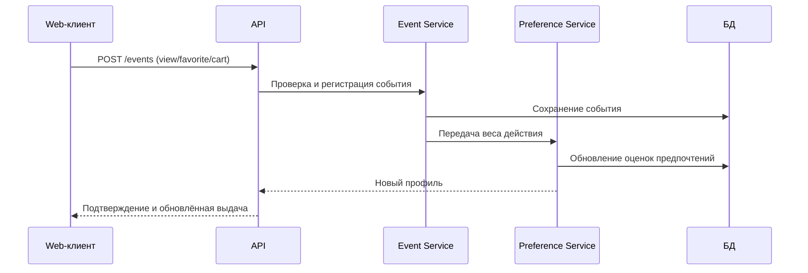
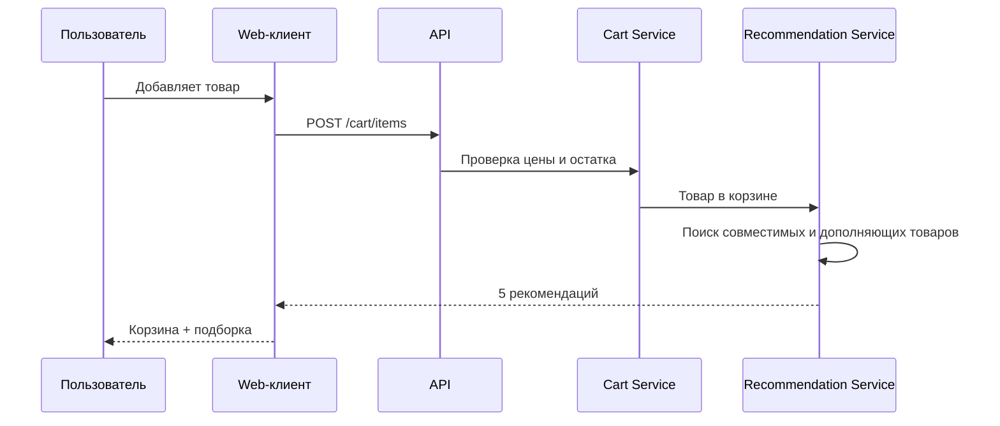

# Диаграммы проекта GadgetStore

## Архитектура компонентов

## ER-модель

## Последовательность: вход и главная

## Последовательность: событие и обновление профиля

## Последовательность: корзина и связанные товары

